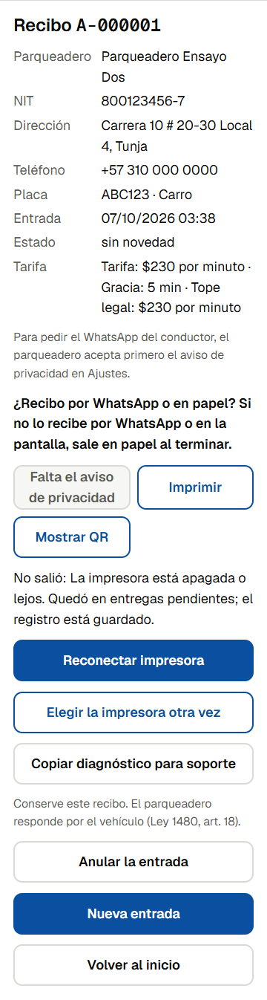
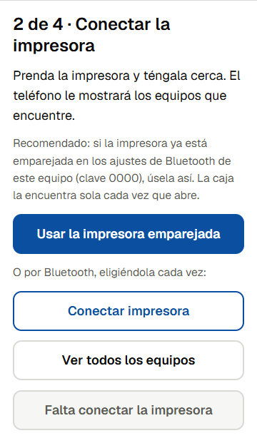
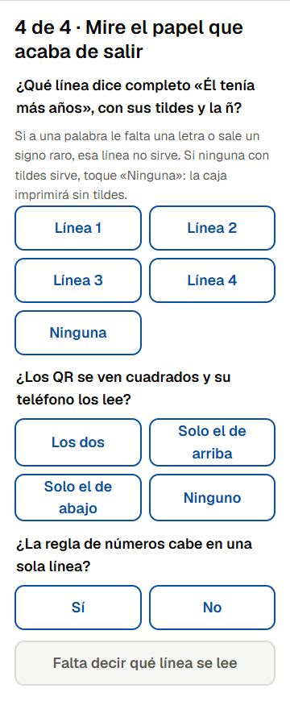

# Runbook: la impresora del parqueadero no imprime

**Para qué:** que quien da soporte resuelva por WhatsApp, sin ir al parqueadero, el fallo más común de la caja (PARQUEADERO §7.4 y §14.5, HU-Q6.2). Sale de lo que pasó con la PT210L del primer cliente (bitácora parqueadero 12, 13, 17, 18, 19 y 21).

**Mientras tanto, nadie se queda sin recibo.** El registro ya está guardado. Desde la pantalla del recibo, **«Enviar por WhatsApp»** o **«Mostrar QR»** le entregan el recibo al conductor, y lo que no salió en papel queda en entregas pendientes (la cabecera lo cuenta).

Los textos en negrita entre comillas (**«así»**) son lo que el cajero ve en la caja. Una prueba de repositorio comprueba que existen (`tests/repo/runbooks-parqueadero.test.ts`).

## 1. Lo primero: el diagnóstico

Pida al cajero que toque **«Copiar diagnóstico para soporte»** y lo pegue en el chat. Está en el recibo que no salió, en el inicio de la caja (debajo de **«Probar la impresora otra vez»**) y en el asistente. Si la caja se recargó, trae también lo de antes, debajo de «Antes de recargar la caja».

| Lo que dice el diagnóstico | Qué es | Vaya a |
|---|---|---|
| `Camino: puerto serie` y `No abrió` | La impresora emparejada no responde: apagada, lejos o sin emparejar | §3 |
| `GATT Server is disconnected` en los 4 intentos, o «La conexión se cayó en los 4 intentos» | El enlace Bluetooth está ocupado: la impresora sigue conectada a otra cosa | §4 |
| «Ningún servicio conocido tiene una característica de escritura» | El equipo elegido no es la impresora, o el teléfono la ve mal | §5 |
| `TimeoutError` | La impresora no contestó a tiempo: lejos o con poca batería | §3 |
| Una línea de tiempo que termina en `desconectada` poco después de `imprimió` | La conexión se cae sola después de imprimir: este teléfono y esta impresora no se llevan por Bluetooth web | §2 |

## 2. El camino: mejor la impresora emparejada

La PT-210 habla dos Bluetooth a la vez (clásico y LE), pero **acepta un solo enlace**. Si el teléfono la tiene emparejada, Android puede abrir su propio enlace y dejar a la caja por fuera; su luz se queda azul.

Por eso, en un Android con Chrome 138 o posterior, la caja usa la impresora **emparejada**, que va por ese mismo enlace y se reconecta sola cada vez que la caja abre:

1. En el teléfono: Ajustes → Bluetooth → emparejar la impresora (clave `0000`). Si ya aparece como emparejada, no hay que hacer nada.
2. En la caja: **«Probar la impresora otra vez»** → **«Siguiente»** → **«Usar la impresora emparejada»** → elegir la impresora en la lista de Chrome.

   

3. **«Imprimir página de prueba»** y las tres preguntas (§6).
4. Cerrar la caja del todo y abrirla: la cabecera debe decir **«Impresora conectada»** sin tocar nada.

Si **«Usar la impresora emparejada»** no aparece, Chrome es viejo o no es Chrome: actualícelo (Play Store → Chrome) o abra la caja en Chrome.

## 3. La impresora emparejada no responde

1. ¿Está prendida? La luz debe estar encendida. ¿Tiene batería?
2. ¿Tiene papel, con la cara térmica hacia el cabezal? Un rollo al revés imprime en blanco: así salió la primera página de prueba del primer cliente.
3. Autoprueba: con la impresora apagada, mantener oprimido el botón de avance de papel y prenderla. Si la autoprueba no sale, el problema es la impresora, no la caja.
4. En la caja: **«Reconectar impresora»**. Si no responde, **«Elegir la impresora otra vez»**.

## 4. El enlace está ocupado (luz azul que no se apaga)

1. Cierre las otras apps que usen la impresora: la de la marca, RawBT u otra caja abierta en otra pestaña.
2. Apague y prenda el Bluetooth del teléfono. La luz de la impresora debe volver a verde.
3. En la caja: **«Reconectar impresora»**; si no, **«Elegir la impresora otra vez»**.
4. Si vuelve a pasar en el mismo turno, cambie al camino de la impresora emparejada (§2).

## 5. «Esta impresora no se reconoce»

1. ¿Se eligió la impresora correcta? Su nombre empieza por `PT` (la del primer cliente es `PT210L_30F2`). Si no aparece, en el asistente toque **«Ver todos los equipos»**.
2. Quite el emparejamiento en Ajustes → Bluetooth del teléfono, emparéjela otra vez y repita la conexión. Cuesta un minuto y descarta un vínculo viejo (bitácora parqueadero 13).

## 6. Sale el papel, pero mal

- **Faltan letras después de las tildes** («Entr» por «Entró»): la impresora está en modo chino. En **«Probar la impresora otra vez»**, en la última pantalla, si a alguna línea de «Él tenía más años» le falta una letra, esa no sirve. Si ninguna sirve, toque **«Ninguna»**: la caja imprime sin tildes y no se pierde nada (bitácora parqueadero 19).

  

- **El QR no se lee**: en la misma pantalla, conteste cuál QR leyó su teléfono; la caja usa ese.
- **La regla de números no cabe en una línea**: conteste que no; la caja usa 30 columnas.

## 7. Si nada funciona

- El cajero sigue con **«Enviar por WhatsApp»**, **«Mostrar QR»** y el talonario.
- Quien da soporte guarda el diagnóstico en el hilo del proyecto y lo anota en la matriz (`docs/parking/validacion/impresion-pt210.md`). Si es un fallo nuevo, abre una entrada en `docs/parking/BITACORA-PARKING.md`.
