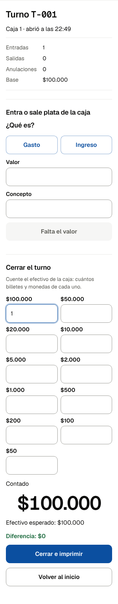

# Runbook: puesta en marcha de un parqueadero

**Para qué:** dejar la caja del parqueadero lista para su primer turno real, en el orden del plan (BACKLOG-PARKING_MVP §8.1 y §8.2, PARQUEADERO §14.5, HU-Q6.2). Se hace en el parqueadero, con el cliente, en una hora más o menos.

Los textos en negrita entre comillas (**«así»**) son lo que se ve en la caja. Una prueba de repositorio comprueba que existen (`tests/repo/runbooks-parqueadero.test.ts`).

## Antes de ir

- El teléfono de la caja: Android con Chrome 138 o posterior (Chrome → Ajustes → Acerca de Chrome), cargado.
- La PT-210 del cliente con batería y rollos de 57 mm. En el kit: una PT-210 de repuesto, un rollo, cargador y cable.
- Los datos del cliente comparados con un recibo suyo: nombre, NIT con dígito, dirección, ciudad, teléfono, póliza si tiene, y sus tarifas contra el tope de su ciudad (`content/parqueadero/topes.json`).
- El aviso de privacidad impreso y la hoja de una página para el cajero.

## En el parqueadero

1. **La caja en el teléfono.** Chrome → `parqueadero.laboratorio-digital.app/caja/` → menú → «Agregar a pantalla de inicio». Ábrala desde el ícono. Si la cabecera dice «Este navegador puede borrar la caja si se llena el teléfono», libere espacio y vuelva a abrirla; si sigue, el respaldo al cierre de cada turno es obligatorio.
2. **La hora.** La cabecera debe decir **«Hora correcta»**. Si dice que está corrida, corrija la hora del teléfono (automática) antes de seguir: de esa hora sale lo que se cobra.
3. **La sede.** **«Ajustes del parqueadero»**: los datos legales, **«¿Cuándo sale el recibo en papel?»** en **«Siempre, al registrar»** durante el piloto (D-Q9), las tarifas por vehículo con su tope y el PIN de administrador. El PIN lo escoge el cliente y no se anota en ningún equipo nuestro. Si la ciudad tiene tope en `content/parqueadero/topes.json`, la caja no deja guardar una tarifa por encima. **«Guardar»**.
4. **El aviso de privacidad.** En Ajustes, el cliente lo lee y lo acepta; después, en **«Aviso de privacidad»**, **«Imprimir en la impresora»** o **«Imprimir en hoja carta»**, y se pega a la vista del conductor.
5. **La impresora.** Empareje la PT-210 en Ajustes → Bluetooth del teléfono (clave `0000`). En la caja: **«Configurar impresora»** → **«Siguiente»** → **«Usar la impresora emparejada»** (si no aparece, **«Conectar impresora»**) → **«Imprimir página de prueba»** → las tres preguntas. Si alguna línea de tildes pierde letras, **«Ninguna»**. Detalle en el runbook «La impresora no imprime».
6. **Que vuelva sola.** Cierre la caja del todo y ábrala: la cabecera debe decir **«Impresora conectada»** sin tocar nada.
7. **WhatsApp.** WhatsApp Business del parqueadero instalado y abierto con su número. Haga una entrada de práctica en el Android del equipo, no en la caja del cliente, y **«Enviar por WhatsApp»** al teléfono del dueño.
8. **El turno.** **«Abrir turno»**: quién atiende y la base de caja. Desde aquí, cada carro recibe el recibo de la caja y el del talonario de siempre.

## Si la caja es un PC con Windows y la PT-210 va por USB

Es el diálogo de impresión del equipo (HU-Q2.5, PARQUEADERO §7.5): un respaldo, no el camino principal. El texto sale como imagen, más lento que por Bluetooth, y sirve también para una impresora común.

1. **El driver.** Instale el driver POS58 de la PT-210 y conéctela por USB. En Windows → Configuración → Impresoras y escáneres, déjela como **impresora predeterminada** y, en sus preferencias de impresión, con el papel de 58 mm del driver.
2. **El acceso directo, para no ver el diálogo en cada recibo.** En el escritorio: clic derecho → Nuevo → Acceso directo. En la ubicación escriba, con las comillas:

   ```text
   "C:\Program Files\Google\Chrome\Application\chrome.exe" --kiosk-printing --app=https://parqueadero.laboratorio-digital.app/caja/
   ```

   Si Chrome está en `C:\Program Files (x86)\…`, use esa ruta. Llámelo «Caja del parqueadero». Con `--kiosk-printing`, Chrome imprime en la impresora predeterminada sin preguntar.
3. **Chrome cerrado del todo antes de abrirlo.** La opción solo vale si Chrome arranca con ella: cierre todas sus ventanas y, en Chrome → Configuración → Sistema, apague «Seguir ejecutando aplicaciones en segundo plano». Desde entonces, la caja se abre siempre con ese acceso directo.
4. **En la caja.** **«Configurar impresora»** → **«Siguiente»** → **«Usar el diálogo de impresión»** → **«Siguiente»** → **«Imprimir página de prueba»**: la página sale sola en la PT-210. **«Siguiente»** y, si salió completa, con tildes y un QR que su teléfono lee, **«Sí»** → **«Guardar»**. Si salió cortada o en blanco, revise el papel de 58 mm en las preferencias del driver y repita.
5. **Que vuelva sola.** Cierre la caja y ábrala con el acceso directo: la cabecera debe decir **«Impresora conectada»**, sin elegir nada.

Sin el acceso directo, cada recibo abre el diálogo de Chrome: se elige la PT-210 y se imprime. Funciona igual, con un paso más por carro.

## Al cierre del primer turno

1. **«Cerrar turno»**: contar billetes y monedas, el motivo si hay diferencia, **«Cerrar e imprimir»**. Comparar el papel con el talonario.

   

2. **«Hacer el respaldo»** y compartirlo al correo o al Drive del dueño del parqueadero. La cabecera dice la fecha del último respaldo.
3. Anotar el resultado en la matriz (`docs/parking/validacion/impresion-pt210.md`) y la primera fila del registro del piloto.
