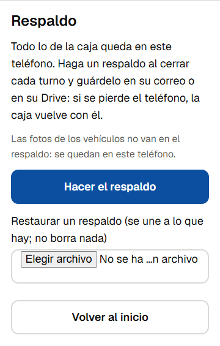

# Runbook: restaurar la caja en otro teléfono

**Para qué:** si el teléfono de la caja se pierde, se daña o se cambia, que el parqueadero siga con sus registros y su numeración desde el último respaldo (PARQUEADERO §5.3 regla 6, HU-Q3.10, HU-Q6.2).

## Lo que vuelve y lo que no

| Vuelve | No vuelve |
|---|---|
| Entradas, salidas, anulaciones, turnos y entregas | Las fotos de los vehículos: viven en el teléfono viejo |
| La sede, las tarifas y su historial | Los números de WhatsApp de los conductores: nunca salen del teléfono |
| La numeración: el siguiente recibo sigue donde iba | La impresora: se configura otra vez en el teléfono nuevo |
| Los vehículos que estaban adentro | Lo que se registró después del último respaldo |

## Pasos

1. **En el teléfono nuevo**, con Chrome 138 o posterior, instale la caja (runbook «Puesta en marcha», paso 1). **No llene los ajustes todavía:** una caja con su sede ya guardada rechaza el respaldo de otra sede.
2. Descargue el archivo del respaldo (`parqueadero-AAAA-MM-DD-HHMM.json`) del correo o del Drive.
3. En la caja: **«Respaldo»** → **«Restaurar un respaldo»** → elija el archivo. Debe decir cuántos datos agregó y «No se borró nada».

   

4. Si dice que el archivo no se puede usar, la caja quedó como estaba. El archivo está cortado o editado, o es de otro parqueadero: pida otro respaldo.
5. Revise en el inicio que los vehículos que estaban adentro aparezcan.
6. **«Configurar impresora»** (runbook «La impresora no imprime», §2) y el PIN, si el cliente quiere cambiarlo, en **«Ajustes del parqueadero»**.
7. **«Abrir turno»** y una entrada: su número debe seguir al último del respaldo.

## Restaurar encima de una caja que ya tiene datos

Se puede: la restauración **une**. Agrega lo que falta por su identificador y no toca lo que ya está, así que restaurar un respaldo viejo no borra los registros nuevos. Sirve, por ejemplo, para recuperar un turno de otro teléfono del mismo parqueadero.
